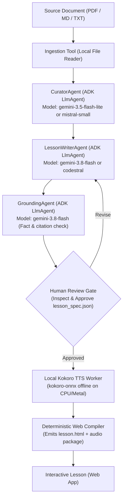

# Chalk-ADK: Interactive Lessons Project Plan

A reimagining of **[OlixIgnacious/chalk](https://github.com/OlixIgnacious/chalk)** built with **Google Agent Development Kit (ADK)** (`google-adk`), focused exclusively on generating **source-grounded, fact-checked interactive web lessons** under free-tier API and compute constraints.

---

## 1. Core Architecture & Philosophy

The foundational principle of `chalk` is preserved: **strict source attribution and pedagogical pacing (Plan → Gate → Build → Check)**. Every claim, narration line, and checkpoint question must trace back to verifiable line ranges in the source text.



---

## 2. Multi-Model & Free-Tier Strategy

To remain 100% functional on **free tiers** (avoiding paid bills and rate-limit lockouts):

### A. Primary Engine: Google Gemini Free Tier
* **Ingestion & Outlining**: `gemini-3.5-flash-lite` (low latency, high free-tier rate limits, quota-friendly).
* **Scripting & Fact-Checking**: `gemini-3.8-flash` (superior reasoning, long-horizon comprehension, fine-grained grounding).
* **Rate-Limit Safeguards**:
  * Free-tier cap is typically 15 RPM (Requests Per Minute) / 1,500 RPD.
  * Pipeline is batched into a strict **3-call sequence** per lesson rather than chatty micro-agents.
  * Structured outputs via Pydantic models eliminate JSON formatting retries.
  * Built-in 4.5-second pacing delay between agent steps prevents 429 errors.

### B. Secondary / Fallback: Open APIs via ADK's `LiteLlm`
Google ADK natively supports multi-provider models through `google.adk.models.lite_llm.LiteLlm`. We can tap into free tiers from:
* **Mistral AI (`MISTRAL_API_KEY`)**:
  * `mistral/mistral-small-latest` (fast, free exploration tier)
  * `mistral/codestral-latest` (specialized for technical/coding lessons)
* **Groq (`GROQ_API_KEY`)**:
  * Ultra-fast inference with generous free-tier RPM for Llama 3.3 / Mistral.
* **OpenRouter (`OPENROUTER_API_KEY`)**:
  * Free open-source endpoints (`:free` models) as zero-cost backups.

### C. Offline Voice & Render ($0 Compute)
* **Narration**: Local `kokoro-onnx` (Python, runs locally on CPU/Metal). Studio-grade 82M parameter TTS requiring zero external API calls or GPU servers.
* **Hosting / Delivery**: Standalone static HTML/JS/CSS web bundle (`lesson.html`). Can run locally (`file://` or `python -m http.server`) or deploy to GitHub Pages / Firebase Hosting free tier.

---

## 3. The Target Deliverable: Interactive Lesson (`lesson.html`)

An interactive lesson consists of:
1. **Audio-Driven Segments**: 3 to 6 bite-sized concepts (45–90 seconds each) voiced by Kokoro. The audio timeline acts as the master clock.
2. **Synchronized Visual Board**:
   * Dynamic slides with syntax-highlighted code blocks, progressive reveals, and diagrams (Mermaid / SVG).
   * Visual cues update in lockstep with the spoken audio timestamps.
3. **Interactive Checkpoint Questions**:
   * Playback halts between segments.
   * Learner is presented with an interactive comprehension check (multiple-choice, concept prediction, or code fill-in).
   * Feedback immediately explains *why* the answer is correct or incorrect, citing the exact source material.
4. **Grounding Inspector**:
   * An interactive drawer that displays the verified source paragraph behind every claim and quiz question.

---

## 4. ADK Agent Roster & Workflow Design

```python
# Conceptual Agent Definitions in ADK
from google.adk.agents import LlmAgent
from google.adk.models.lite_llm import LiteLlm

# Primary Gemini Agents
curator_agent = LlmAgent(
    name="curator_agent",
    model="gemini-3.5-flash-lite",
    instruction="Extract core concepts and build a progressive 3-5 unit outline."
)

writer_agent = LlmAgent(
    name="writer_agent",
    model="gemini-3.8-flash",
    instruction="Write narration scripts, visual layout specs, and checkpoint questions."
)

verifier_agent = LlmAgent(
    name="verifier_agent",
    model="gemini-3.8-flash",
    instruction="Verify factual accuracy, check question fairness, and ensure strict source grounding."
)

# Optional Mistral Agent using ADK's native LiteLlm integration
mistral_writer = LlmAgent(
    name="mistral_writer",
    model=LiteLlm(model="mistral/mistral-small-latest"),
    instruction="Alternative script and question generator for coding lessons."
)
```

---

## 5. Project Directory Structure

```
chalk-adk/
├── PLAN.md                      # This architecture plan
├── pyproject.toml               # Dependencies: google-adk, google-genai, litellm, kokoro-onnx, soundfile, pydantic
├── .env.example                 # GEMINI_API_KEY, MISTRAL_API_KEY (optional), GROQ_API_KEY (optional)
├── src/
│   ├── __init__.py
│   ├── config.py                # Model selection, rate limiter, API keys
│   ├── schemas/
│   │   ├── __init__.py
│   │   └── lesson.py            # Pydantic models (LessonSpec, Segment, Checkpoint, Question)
│   ├── agents/
│   │   ├── __init__.py
│   │   ├── curator.py           # Ingestion and curriculum outline agent
│   │   ├── writer.py            # Segment narration & quiz authoring agent
│   │   └── verifier.py          # Grounding and fact-checking agent
│   ├── tools/
│   │   ├── __init__.py
│   │   ├── document_parser.py   # PDF / Markdown / Text reader
│   │   └── tts_worker.py        # Local kokoro-onnx voice generator
│   ├── compiler/
│   │   ├── __init__.py
│   │   ├── builder.py           # Injects JSON spec and audio into lesson bundle
│   │   └── template/            # Modern standalone interactive player
│   │       ├── index.html
│   │       ├── player.js
│   │       └── style.css
│   ├── workflow.py              # ADK workflow definition linking agents
│   └── cli.py                   # Main CLI entrypoint
└── examples/
    └── sample_source.md         # Example source file for testing
```

---

## 6. Implementation Roadmap

### Phase 1: Environment & Data Models
- [ ] Initialize Python virtual environment with `uv` or `venv`.
- [ ] Install `google-adk`, `google-genai`, `litellm`, `pydantic`, `kokoro-onnx`, and `soundfile`.
- [ ] Define comprehensive Pydantic models in `src/schemas/lesson.py`:
  - `SourceChunk`, `LearningObjective`, `VisualDirective`, `CheckpointQuestion`, `LessonSegment`, `LessonSpec`.
- [ ] Build `src/config.py` with multi-provider routing (Gemini + Mistral fallback) and request pacing.

### Phase 2: ADK Multi-Agent Pipeline
- [ ] Implement `CuratorAgent` (`src/agents/curator.py`): Ingests raw source, returns structured outline.
- [ ] Implement `LessonWriterAgent` (`src/agents/writer.py`): Expands outline into spoken scripts, visual directives, and checkpoint quizzes.
- [ ] Implement `GroundingAgent` (`src/agents/verifier.py`): Flags hallucinations, ungrounded claims, or ambiguous questions.
- [ ] Implement `HumanApprovalGate`: Terminal preview and breakpoint allowing user to approve or edit the generated `lesson_spec.json`.

### Phase 3: Interactive Lesson Player Template
- [ ] Build responsive, zero-dependency HTML5/Tailwind/Vanilla JS player in `src/compiler/template/`.
- [ ] Features:
  - Audio playback synchronization with progress scrub.
  - Interactive slide area supporting Markdown, code blocks with line highlights, and diagrams.
  - Checkpoint modal: Pauses audio, tests learner, displays grounded explanations for right/wrong options.
  - Source grounding inspector drawer.

### Phase 4: Local Audio Generation & Compiler
- [ ] Implement `tts_worker.py` using `kokoro-onnx` to generate WAV/MP3 files per segment.
- [ ] Implement `builder.py` to assemble `lesson_spec.json`, generated audio files, and HTML template into a self-contained output directory (`dist/<lesson_title>/`).

### Phase 5: CLI & Testing
- [ ] Create `cli.py` with commands:
  - `python -m src.cli create <source_file> [--model gemini|mistral]`
  - `python -m src.cli preview <dist_folder>`
- [ ] Test end-to-end with a sample technical document or chapter.

